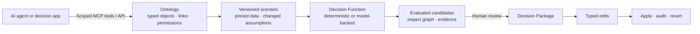
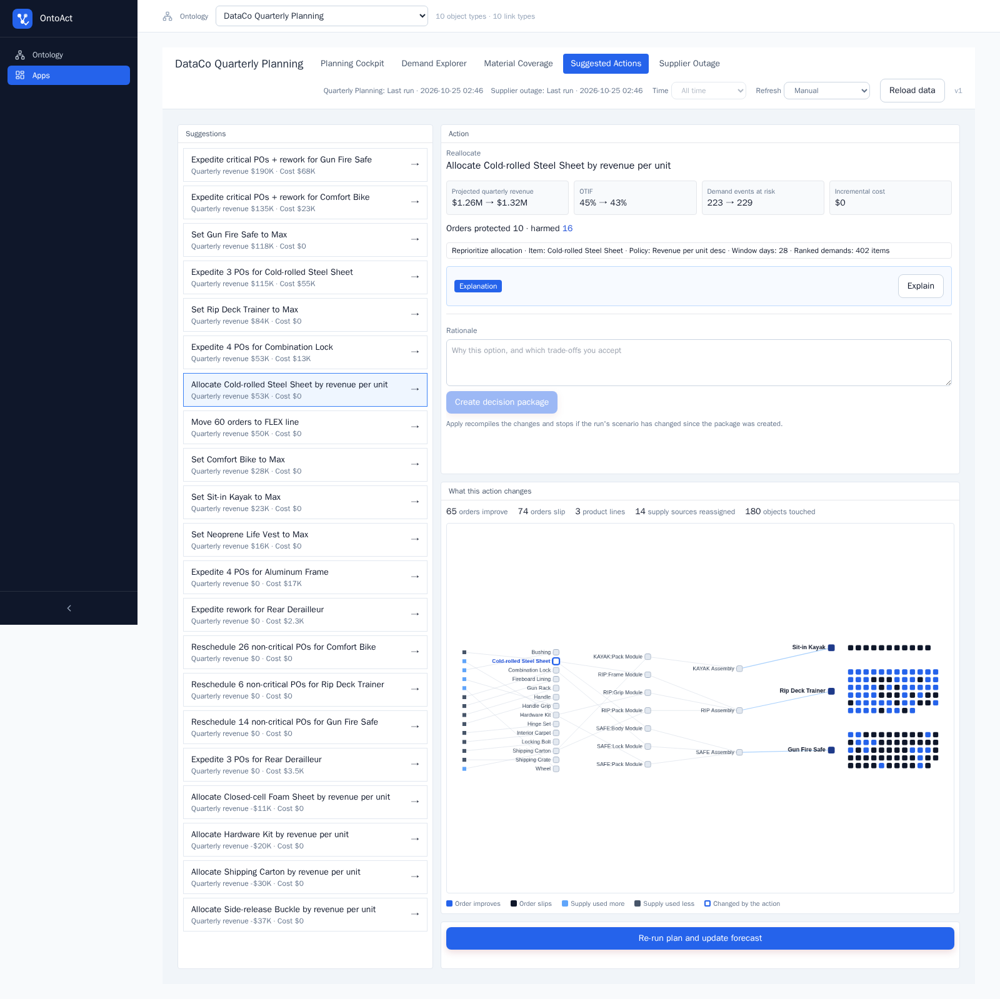
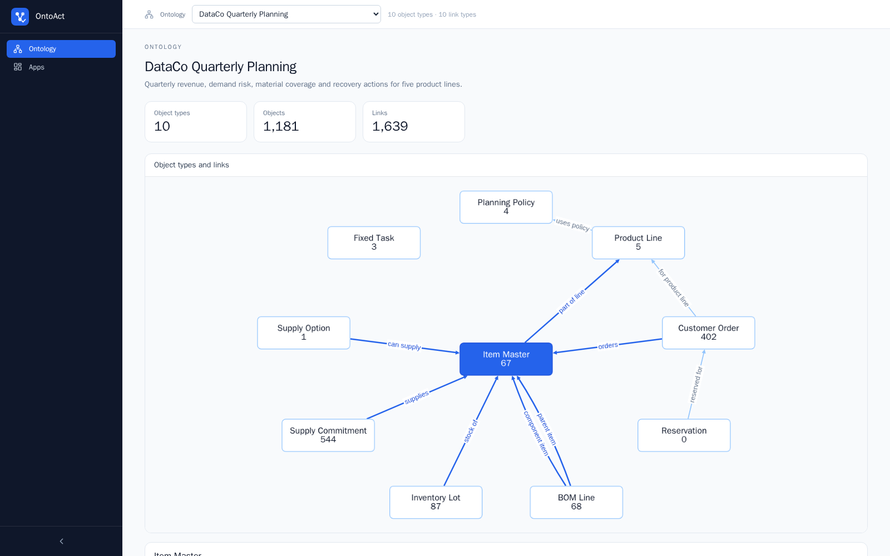
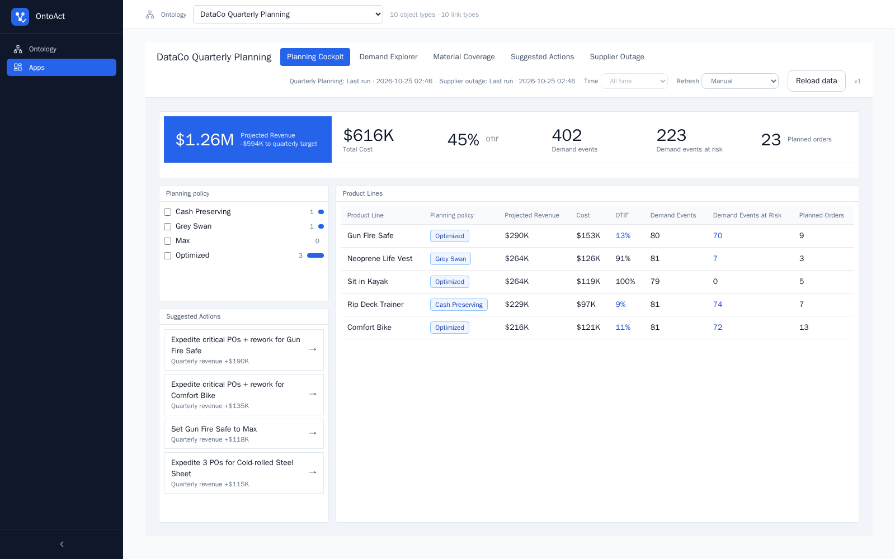
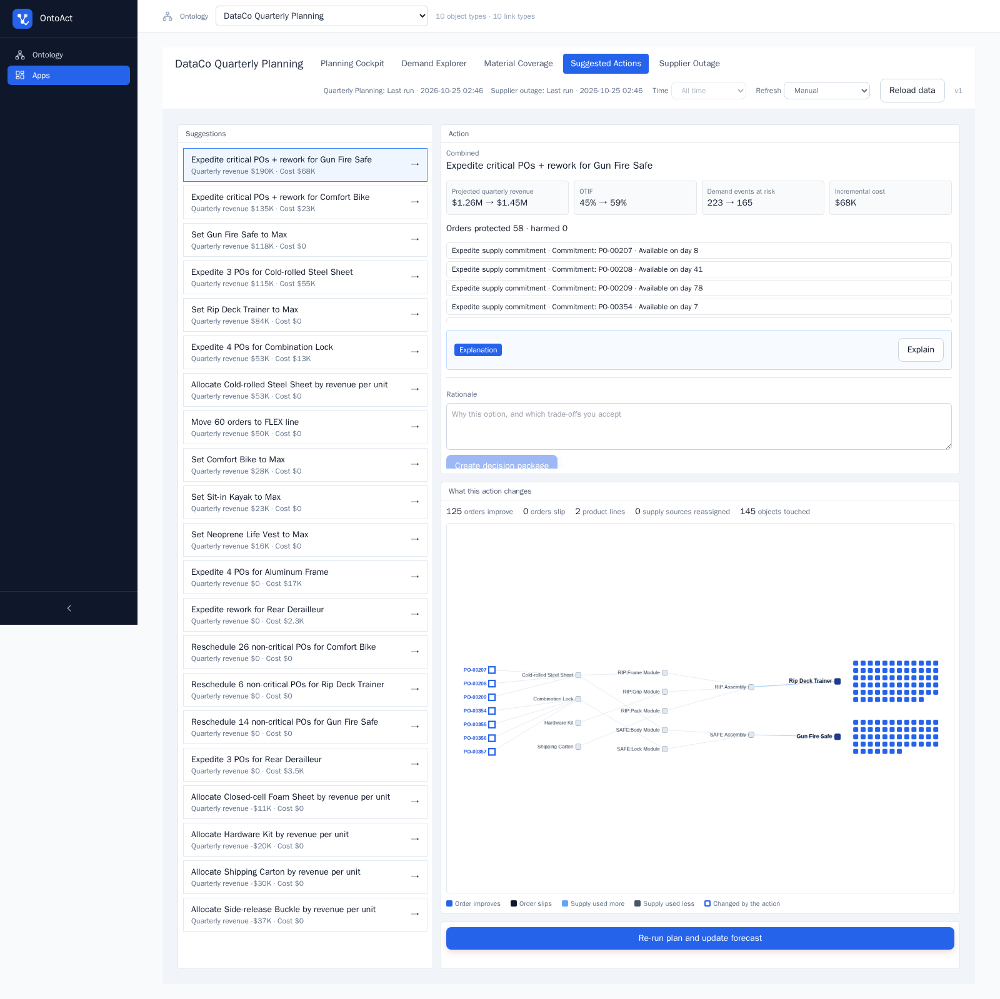
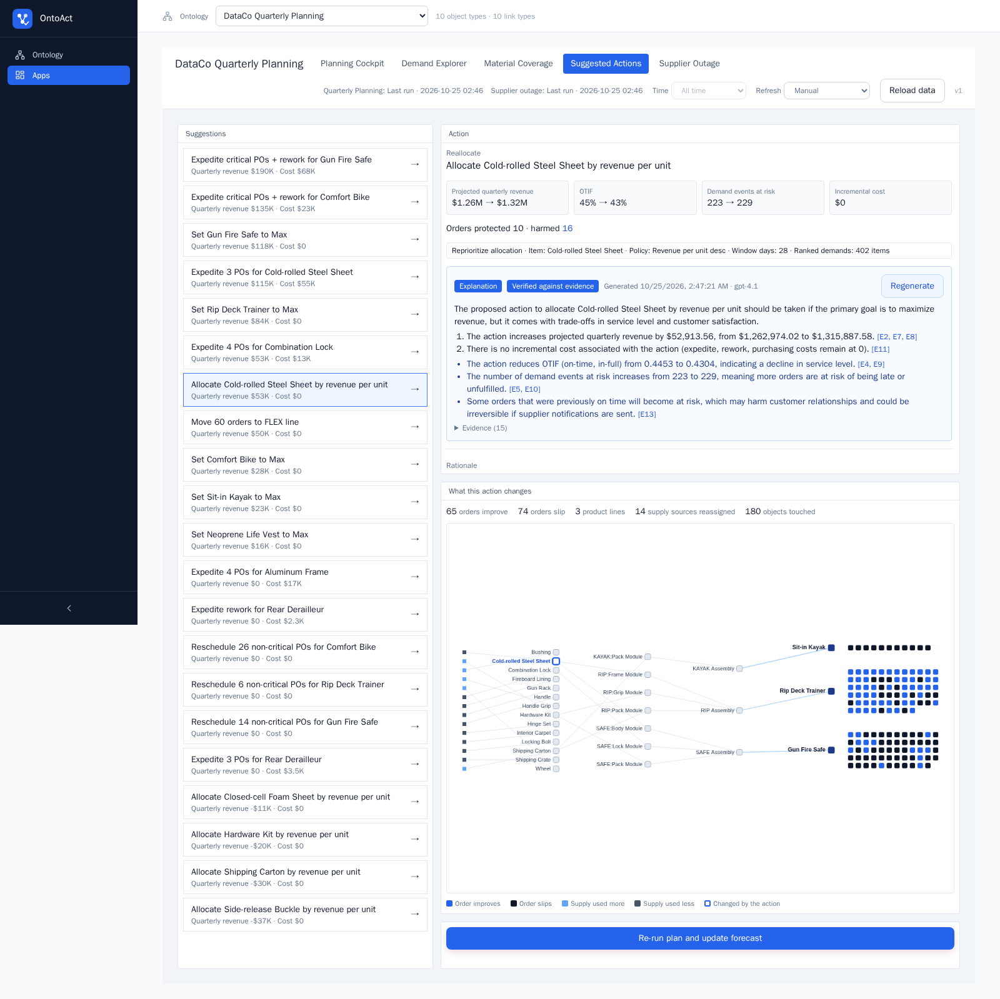
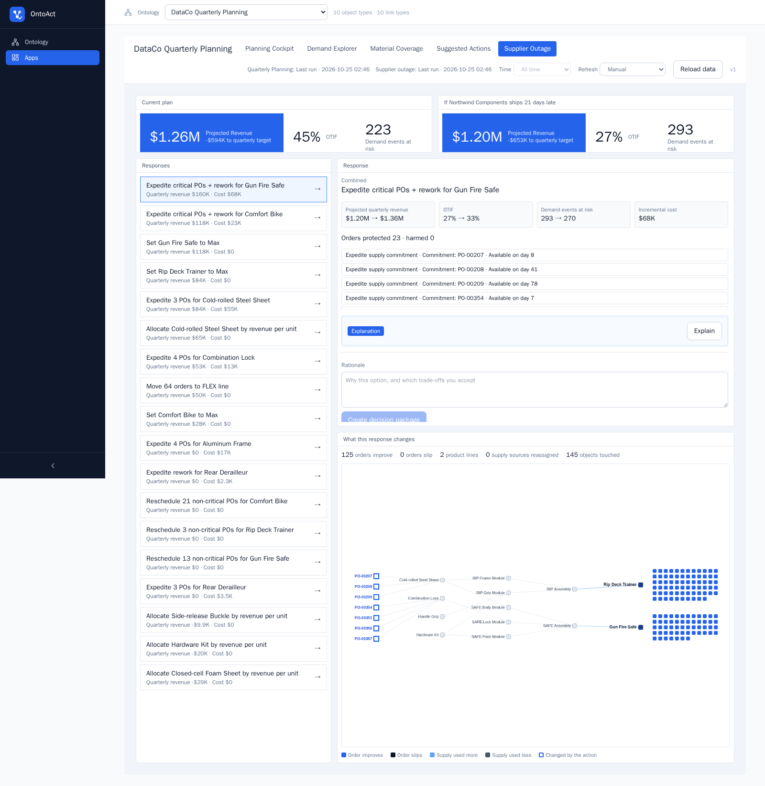
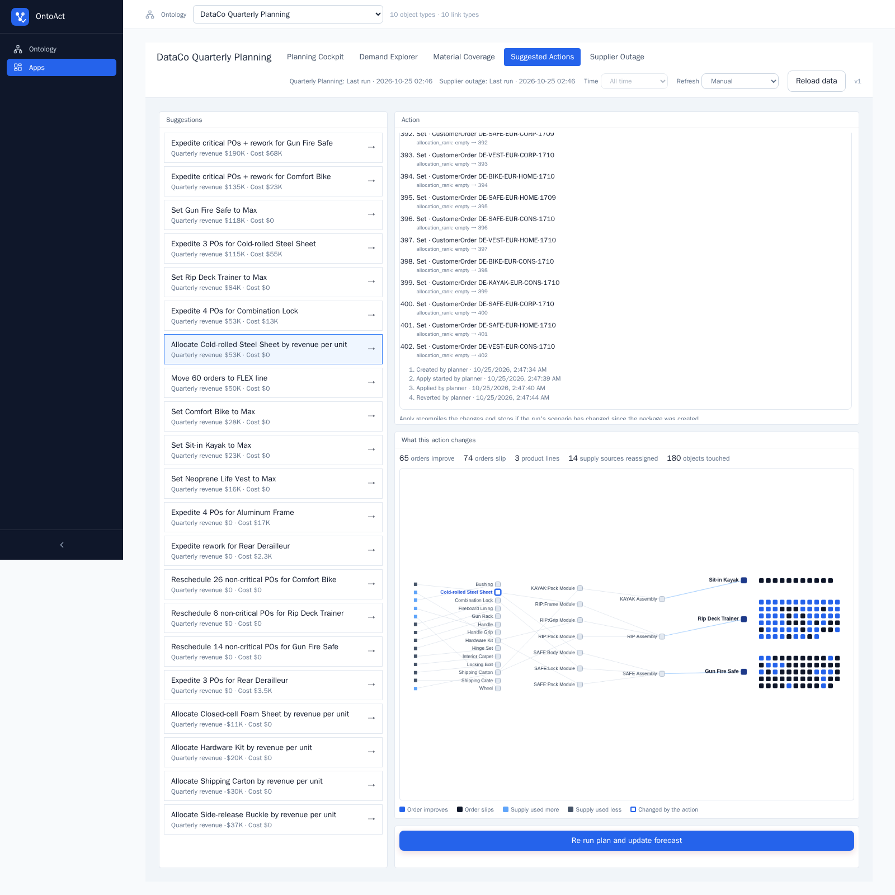
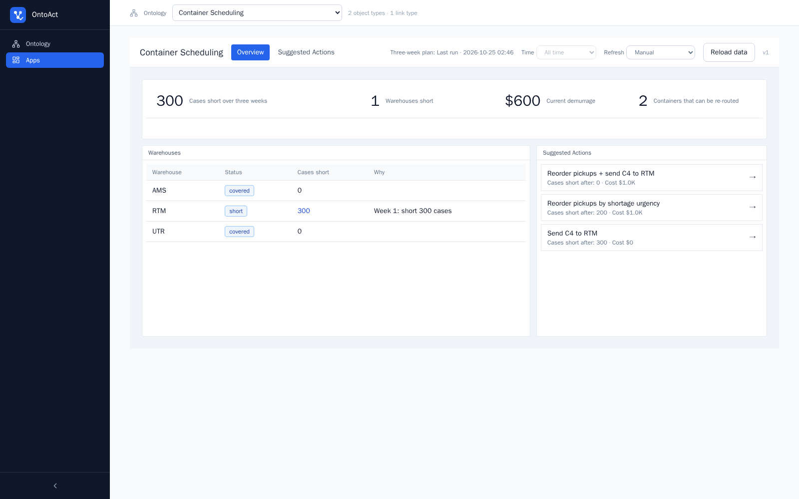

<p align="center"></p>
<h1 align="center">OntoAct</h1>
<p align="center"><strong>Decision infrastructure for AI agents that need to act, not just answer.</strong></p>
<p align="center">Typed operational context · Counterfactual simulation · Governed write-back</p>

<p align="center">
  <a href="https://github.com/sylvia-yyl/ontoact-coupled/actions/workflows/ci.yml"></a>
  <a href="LICENSE"></a>
  
  
  
  <a href="https://github.com/sylvia-yyl/ontoact-coupled/stargazers"></a>
</p>

<p align="center">
  <a href="#why-agents-need-more-than-rag">Why OntoAct</a> ·
  <a href="#bring-your-own-data-and-decisions">Bring your data</a> ·
  <a href="#walkthrough">Walkthrough</a> ·
  <a href="#quick-start">Quick start</a> ·
  <a href="#tests">Verification</a>
</p>

OntoAct gives an agent a typed, connected model of an operational world; lets it evaluate actions against a pinned scenario; and turns the selected action into reviewed, auditable and reversible writes.

| 🧠 Structured context | 🧪 Counterfactuals | 🛡️ Governed actions | 🔌 Agent-native | ↩️ Reversible |
|---|---|---|---|---|
| Objects, links and permissions | Re-run logic under changed assumptions | Typed edits with version checks | Scoped tools over MCP | Audit every change and restore it |

## Why agents need more than RAG

RAG is useful for finding passages that may answer *what is true*. Operational agents also need to answer *what will happen if I do this?*, *what else will change?*, and *is it still safe to apply?* Those questions require relationships, constraints, simulation and transaction semantics—not another generated paragraph.

| A retrieval-only agent often has | OntoAct adds |
|---|---|
| Chunks that mention orders, parts and suppliers | Typed business objects connected by explicit links |
| Context assembled at request time | A version-pinned data view and reproducible scenario |
| An LLM-generated recommendation | Candidate actions evaluated by deterministic or user-supplied Functions |
| A textual answer with no executable contract | Typed Ontology edits with optimistic version checks |
| No safe boundary between recommendation and action | Human review, idempotent apply, audit history and revert |



The LLM is deliberately not the source of truth. It can explain a candidate using cited evidence, while the numbers come from re-running the decision Function and the final write is guarded by version checks. The simulation, action lifecycle and MCP access all work without an LLM key.

OntoAct is not tied to manufacturing. The repository includes two deliberately different examples: quarterly production planning over **31,418 real customer order lines**, and container scheduling driven by a user-supplied Python Function. They share the same object, scenario, action and application runtimes while using different ontologies, logic and page configurations.



## Bring your own data and decisions

A domain is a folder in `demo_cases/<case>/`; it is a portable contract rather than application code:

| You provide | Purpose | Replace without changing the platform |
|---|---|---|
| `ontology.json` | Object types, properties and links | Products and orders can become vessels and jobs, patients and resources, or any other business objects |
| `objects.jsonl` and `links.jsonl` | Your operational data | Export from a database, warehouse or existing system into the documented pack format |
| `study.json` | Inputs, decision Function and allowed action types | Use the built-in planning Function or ship your own isolated Python Function |
| `app.json` | Pages, widgets, bindings and navigation | Build a domain-specific app from standard widgets without adding frontend code |
| `cases.json` (optional) | Reproducible what-if scenarios | Encode disruptions, policy changes or alternative assumptions |

Fork the repository, copy either bundled case, replace these files, and load it with:

```sh
docker compose exec backend python scripts/seed_case.py <your-case>
```

The current repository intentionally starts at the case-pack boundary. It does not yet include a catalog of ready-made SAP, Snowflake or SaaS connectors; teams either export JSON/JSONL packs or integrate through the object APIs. The platform above that boundary is domain-independent.

### What stays generic

- **Ontology and data plane:** typed objects, links, graph traversal, object queries and pinned data views.
- **Decision runtime:** versioned studies and scenarios, built-in or user-supplied Functions, and isolated Function execution.
- **Action lifecycle:** candidate comparison, typed edits, optimistic version checks, idempotent commands, audit records and revert.
- **Application layer:** pages and widgets are defined by configuration and bound to run outputs.
- **Agent access:** scoped Ontology queries are exposed over MCP; the core simulation and write-back flow does not require an LLM.

## What it answers

| Question | What OntoAct shows |
|---|---|
| We are $594K short of the quarter's target. What should we do? | 21 candidate actions (expedites, rework, reallocation of shared parts, moves to a flex line, policy changes), each evaluated by re-running the full plan |
| What does an action cost the other lines? | Orders protected and harmed, the product lines involved, and an impact graph of every order, part and supply source that changes |
| A supplier ships three weeks late. How bad is it, and what is the best response? | The plan re-run on a what-if scenario (179 purchase orders moved), side by side with the current plan, and recovery actions for that scenario |
| Can we act on it safely? | An explanation whose numbers are checked against the simulation, then a decision package that applies the action as Ontology edits, keeps an audit trail and can be reverted |

## Walkthrough

### 1. The ontology

Ten object types and 1,181 objects linked by 1,639 references: customer orders, product lines, items, bill-of-materials lines, inventory lots, purchase orders, supply options, planning policies and maintenance windows.



### 2. The quarter at a glance

The planner allocates material and line time to 402 demand events (one per product, market, customer segment and month) and projects revenue, cost and on-time delivery for the quarter.



### 3. Trade-offs across product lines

Steel sheet is short and used by both the gun safe and the trainer. A safe sells for $400 but needs 8 sheets, about $50 per sheet; a trainer earns $60 per sheet. Allocating steel by revenue per sheet adds **$52.9K this quarter at no cost**. It also protects 10 trainer orders and pushes 16 others late, kayaks among them, even though kayaks use no steel: the trainers that can now be built take shipping cartons that kayaks needed. The impact graph shows the chain from the steel sheet through modules and assemblies to the orders that improve (blue) and slip (black).

Fixing every critical part of the safe line, steel included, also rescues 52 trainer orders, because the two lines draw on the same steel:



### 4. An explanation checked against the numbers

The explanation is written by an LLM from evidence the planner produced. Every figure in it is checked against that evidence before it is marked verified, and each claim cites the evidence it rests on.



### 5. A supplier outage

The outage case moves every open purchase order from Northwind Components 21 days later in a scenario, then runs the same plan. On-time delivery drops from 45% to 27% and 70 more demand events are at risk. The best response recovers $160K at a cost of $68K.



### 6. Apply and revert

A decision package compiles the action into typed Ontology edits (402 allocation ranks here), checks them against the data version the plan used, applies them and records who did what. Revert restores every edited value.



### 7. Another domain, same workbench

The container scheduling case uses no planning code from the DataCo case. Its decision logic is a user-written Python Function that runs in an isolated container, and its pages are a different app configuration.



## How it works

```
demo_cases/<case>/          ontology, objects, links, study, app, what-if cases
  -> Ontology               object types in PostgreSQL, a graph projection in FalkorDB
  -> Study run              object queries feed a planning Function, pinned to one data version
  -> Candidates             each action re-runs the same simulation; outcome, accounting and impact graph
  -> Explanation            LLM text, every number checked against the run's evidence
  -> Decision Package       compiled Ontology edits -> apply -> audit trail -> revert
  -> Apps                   pages defined as configuration, bound to run outputs
```

The planner, `backend/app/services/v2/mrp_planning.py` on top of `material_shortage.py`, explodes bills of materials and allocates stock and purchase orders in time-phased order. It schedules each build on its line (or an alternate line) around maintenance windows and evaluates every candidate by re-running that same simulation with one change. The other parts:

- **Impact graphs** are derived from the difference between two simulations.
- **Write-back** goes through `compile_candidate` in `material_shortage_objects.py`, which turns each action into the property edits the planner reads, so re-planning after an apply reproduces the candidate's prediction.

### Not tied to the sample data

- The planner reads object types and properties, not case names. Tests run it on hand-built two-line portfolios with hand-checked answers and on 40 random portfolios, unrelated to DataCo. On those portfolios they check determinism, material conservation and consistent accounting. They also write each candidate's actions back, re-plan from scratch and assert the result equals the prediction.
- The frontend has no case-specific code. Pages, widgets and bindings come from `app.json`, so a new case is a new pack and app, not new code.
- Any case is a folder in `demo_cases/` loaded by `scripts/seed_case.py <case>`. The planning Function expects these object types:

| Object type | Properties the planner reads |
|---|---|
| CustomerOrder | item, product_line, quantity, due_at, unit_revenue, processing_days, resource; optional alternate_resources, priority, allocation_rank |
| ProductLine | code, name, policy, conversion_cost, resource |
| PlanningPolicy | code, capacity_factor, conversion_factor, pull_in_days, exclude_low_confidence |
| ItemMaster | code, kind, product_line (empty for shared parts), unit_cost, critical |
| BOMLine | parent_item, component_item, quantity_per |
| InventoryLot | item, location, quantity |
| SupplyCommitment | item, quantity, available_at, unit_cost, supplier; optional expedite_available_at, expedite_unit_premium, confidence |
| SupplyOption, FixedTask, Reservation | alternate or rework supply, maintenance windows, reserved stock (all optional) |

Days are offsets from the study's planning date. A case with different decision logic can ship its own Python Function instead, as the container case does.

## Quick start

Requirements: Docker with Compose, and a POSIX shell for the bootstrap script.

```sh
sh scripts/bootstrap.sh                 # writes .env with fresh local secrets
docker compose up -d --build
docker compose exec backend python scripts/seed_case.py dataco_mrp
docker compose exec backend python scripts/seed_case.py container_scheduling
```

Open http://localhost:5173. The seed script prints the app URL; the API is at http://localhost:8000.
Re-running a case is safe: the seed script stops if that case is already present. Pass `--new-copy` only when you intentionally want a separate timestamped copy.

If either port is already in use, choose free host ports without editing the Compose file:

```sh
BACKEND_PORT=18000 FRONTEND_PORT=15174 docker compose up -d --build
```

Explanations need an OpenAI-compatible API: set `OPENAI_API_KEY` (and optionally `OPENAI_BASE_URL`, `EXPLANATION_MODEL`) in `.env` and restart the backend. Everything else works without it.

### Using the Ontology from an agent

The API serves Ontology queries as tools over the Model Context Protocol (streamable HTTP) at `http://localhost:8000/api/v2/mcp/`. Nothing is open by default: a client sends the bearer token of one MCP scope, sees only the queries that scope lists, and every call runs as the scope's owner, so results are limited to what both the scope and that user allow.

## Tests

```sh
cd backend && pytest tests -q          # 170 tests, about 15 seconds, no database needed
cd frontend && npm ci && npm run lint && npm run build
```

| Suite | What it checks |
|---|---|
| `test_planning_known_answers.py` | Hand-built portfolios: shared-part reallocation, expedite cost, flex-line rescue |
| `test_planning_properties.py` | 40 random portfolios: determinism, no source over-allocated, protected and harmed orders disjoint and matching the impact graph, and apply-then-re-plan equals the prediction |
| `test_dataco_pack.py` | Every number quoted in this README, recomputed from the committed pack, including the outage case |

GitHub Actions (`.github/workflows/ci.yml`) runs ruff and the tests for the backend, and lint, type-check and build for the frontend. `frontend/scripts/readme-screenshots.mjs` regenerates the screenshots above with Playwright.

With the stack running and a seeded app, the interaction smoke test deliberately visits pages out of order, combines global controls, selects actions in reverse order, reloads repeatedly, and exercises a reversible decision package:

```sh
cd frontend
BASE_URL=http://localhost:5173 npm run test:interaction-smoke -- <ontology-id> <app-id>
```

## Data

| Part | Source |
|---|---|
| Demand: products, prices, order dates, quantities, markets, customer segments, scheduled shipping days | Real. DataCo Smart Supply Chain, Mendeley Data, doi:10.17632/8gx2fvg2k6.5, CC BY 4.0. Cancelled and suspected-fraud orders are dropped; customer identity columns are never read |
| Supply: bills of materials with shared materials, stock, purchase orders, line and flex capacity, supplier disruptions, quality hold | Rule-derived from the real demand with a fixed seed (no public source exists) |

The pack in `demo_cases/dataco_mrp/` is generated, not hand-edited. To rebuild it, download `DataCoSupplyChainDataset.csv` and run, with Python 3.12, pandas and `backend/requirements.txt` installed:

```sh
python backend/scripts/build_dataco_pack.py path/to/DataCoSupplyChainDataset.csv
```

The script checks the file's SHA-256 first. `--variant independent` builds the earlier pack in which every line owns its parts and its line.

## Architecture

| Concern | Implementation |
|---|---|
| Frontend | React 19, TypeScript, Vite, Tailwind CSS, react-query, Cytoscape.js, ECharts |
| API | FastAPI, Pydantic, SQLAlchemy |
| Objects, runs, scenarios, packages, audit | PostgreSQL |
| Graph projection for traversal | FalkorDB |
| User Functions | Separate `function-runner` container on an internal network, read-only, no capabilities |
| Agent access | MCP Python SDK, streamable HTTP |

## License

[MIT](LICENSE)
